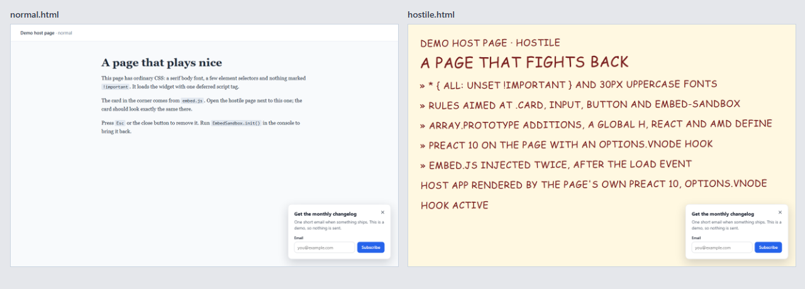

# embed-sandbox

A small Preact embed that keeps working on host pages you don't control.



[](https://github.com/fatih255/embed-sandbox/actions/workflows/ci.yml)

## Why this exists

At Popupsmart I worked on the [Vite and Preact runtime that runs popups on customer sites](https://fatihinci.com/experience/#embedded-web). It served hundreds of millions of CDN requests a month on pages we didn't control, where their CSS, other scripts and loading order could all break it. This repo is a small from-scratch version of that pattern, not the production code, and it starts where I'd start again: the runtime's boundaries written down at the top of [`src/runtime.ts`](src/runtime.ts), saying what it can change on the page, what it owns and what it must clean up when it closes.

## What it shows

The widget is an announcement card with a close button and an email field. The field only validates the address and shows a thank-you state. There's no backend.

```html
<script
  src="https://your-cdn.example/embed.js"
  async
  data-title="Get the monthly changelog"
  data-accent="#2563eb"
  data-position="bottom-right"
></script>
```

- **One script tag, configured with data attributes**: `title`, `message`, `button`, `success`, `position` (`bottom-right`, `bottom-left`), `accent` (hex), `delay` (ms) and `auto` (`false` waits for `EmbedSandbox.init()`). Bad values fall back to defaults with a console warning instead of throwing.
- **A single IIFE file.** Vite reports `dist/embed.js 19.79 kB │ gzip: 8.53 kB`. The build fails if `dist/` holds anything else or the file goes over 10 KiB gzip ([`scripts/check-size.mjs`](scripts/check-size.mjs)).
- **Shadow DOM style isolation.** Styles go into the shadow root. `:host { all: initial !important }` beats the page's own `!important` rules on the host element and stops inherited fonts and colors. The widget's CSS variables are set inside the shadow root, so the page can't hijack them.
- **Safe to load twice, late or early.** A second copy finds the first through a `Symbol.for()` key and stops. A blocking script in `<head>` waits for `DOMContentLoaded`; `async`, `defer` and injected-after-`load` scripts mount right away.
- **Doesn't care about the page's globals.** Preact 11 is bundled inside the IIFE, so a global `h`, a fake `React`, an AMD `define`, `Array.prototype` additions and the page's own Preact 10 with an `options.vnode` hook don't reach it.
- **Clean teardown.** Every listener and timer goes through one helper that records a cleanup. `EmbedSandbox.destroy()`, the close button and `Esc` all run them and remove the single host element.

The API is `window.EmbedSandbox` with `init(overrides?)`, `destroy()`, `status()` and `version`.

## Run it

```sh
npm ci
npm run dev
```

That builds `embed.js` and serves the demo pages at http://127.0.0.1:5101/normal.html and http://127.0.0.1:5101/hostile.html. The hostile page uses `* { all: unset !important }`, 30px uppercase fonts, rules aimed at `.card`, `input` and `embed-sandbox`, polluted globals, and injects the script twice after `load`.

`npm run screenshots` rebuilds and retakes the PNGs in `docs/screenshots/` with Playwright ([normal](docs/screenshots/normal.png), [hostile](docs/screenshots/hostile.png)).

## Tests

```sh
npm test            # Vitest, jsdom
npm run test:e2e    # build, then Playwright in Chromium
npm run typecheck
```

- **Unit (46 tests):** config parsing and validation, init idempotency, waiting for `DOMContentLoaded` and the delay, destroy removing the host element, document listeners and pending timers, close and `Esc`, the email form.
- **E2E (11 tests):** loads both demo pages and compares the computed styles and boxes of every element in the shadow root, in the form, error and thank-you states. It checks that the hostile rules really apply, that double and late loads leave one widget, and that a blocking `<head>` script works. For teardown, an init script wraps `addEventListener` and the timer functions and tags each call by whether `embed.js` is on the stack. After `destroy()` no widget listener or timer is left, the page's own are untouched, and `document.documentElement.outerHTML` matches what it was before `init()`.

CI runs the typecheck, both suites and the size budget.

## Limits

- A `transform` or `filter` on `<html>` or `<body>` changes what `position: fixed` means, and the shadow root can't undo that.
- `@font-face` rules are global, so a page that redefines a font name in the widget's stack can change its text.
- A page that stops events in the capture phase on `document` can block clicks before they reach the shadow root.
- The shadow root is `open` so tests can reach inside. Chromium is the only browser in the e2e run.

## License

MIT, see [LICENSE](LICENSE).
